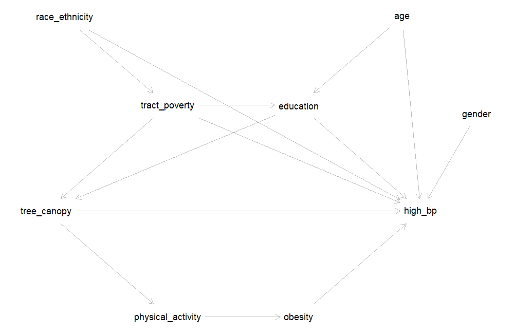

In [Lesson 5](lesson5.qmd) you fit a **crude** (unadjusted) model for tree canopy and high blood
pressure. This lesson asks whether that crude estimate is distorted by **confounding** — a third
variable that is related to both the exposure and the outcome — and what to adjust for. It has
two parts:

1. **Choosing confounders with a DAG** — drawing a directed acyclic graph for tree canopy and high
   blood pressure in R, listing the paths that connect them, and letting the DAG identify a
   **minimally sufficient adjustment set**.
2. **Checking confounding in the data with the change-in-estimate approach** — adding each
   candidate variable to the model one at a time, calculating how much the estimate changes,
   and fitting a final adjusted model.

Both parts end with a **🧠 Your Turn** for the exposure and outcome in your own project. Together
they produce the DAG, change-in-estimate table, and final adjustment set that Milestone 3 asks for.

::: {.callout-important}
## How to use this tutorial

The gray boxes below are **live R editors** — the code actually runs in your browser (no install
needed). Click the green **Run Code** arrow in the top-left corner of a box to run it. The output
will appear directly underneath.

You can also edit the code first — click inside the box, change something, then click **Run
Code** to run your edited version. Nothing you do here can break anything; if you make a mess,
just refresh the page to start that box over.

Sections marked **🧠 Your Turn** give you a task and a blank or partially blank code editor. Try
writing the code yourself before revealing the solution, hidden in a collapsed box underneath.
Boxes labeled **💡 Answers** work the same way: think through the questions first, then click to
check your reasoning.

**A note on browser vs. RStudio code:** chunks labeled `#| autorun: true` fetch data from the web
in the background so it's available in your browser. **When you write your own scripts in
RStudio, you will not include this fetching code.** Immediately after each one, a green box
labeled **"In your RStudio script"** shows the simpler code you'll actually use.
:::

::: {.callout-note}
## Doing this in RStudio instead of (or in addition to) the browser?

This tutorial uses **`class_data_processed.csv`**, the same merged file from Lessons 1, 3, 4, and
5. It uses two packages you may not have installed yet: **`dagitty`** (for DAGs) and
**`sandwich`** (for robust standard errors). Install them once with
`install.packages(c("dagitty", "sandwich"))`. See the [Data Codebook](codebook.qmd) for variable
definitions.
:::

---

# Setup

```{webr-r}
library(tidyverse)
library(sandwich)
library(dagitty)
```

In RStudio:

```r
data <- read.csv(file.path("data_processed", "class_data_processed.csv"))
```

In the browser:

```{webr-r}
#| autorun: true

data_base_url <- "https://raw.githubusercontent.com/schinasi/EOH635/main/data/"

dir.create("data_processed", showWarnings = FALSE)

download.file(paste0(data_base_url, "class_data_processed.csv"), file.path("data_processed", "class_data_processed.csv"))

data <- read.csv(file.path("data_processed", "class_data_processed.csv"))
```

::: {.callout-tip}
## 💻 In your RStudio script

```r
data <- read.csv(file.path("data_processed", "class_data_processed.csv"))
```
:::

Next, recreate two variables from earlier lessons: the cleaned age variable from Lesson 3 (ages
above 105 recoded to missing), and the tree canopy coding we settled on at the end of Lesson 5 —
**top quartile vs. the lower three quartiles**.

```{webr-r}
data <- data %>%
  mutate(
    r_age = ifelse(age > 105, NA, age),                       # Lesson 3: implausible ages -> missing
    tree_quartile = factor(ntile(hrlctree, 4)),               # Lesson 5: canopy quartiles
    tree_top_quartile = ifelse(tree_quartile == "4", 1, 0)    # Lesson 5: Q4 (1) vs. Q1-Q3 (0)
  )

table(data$tree_quartile, data$tree_top_quartile)   # always check a recode
```

::: {.callout-note}
## Why use the top-quartile exposure in this lesson?

Lesson 5 concluded that both a continuous term and "top quartile vs. the rest" were defensible
codings for tree canopy. We use the binary version here because it keeps each model to a single
exposure estimate, which makes the change-in-estimate calculations easy to follow. If your own
exposure is continuous, see the box **"What if my exposure is continuous?"** in Part 2 — there is
one extra step.
:::

---

# Part 1: Choosing Confounders with a DAG

Recall the three conditions for a variable to be a confounder. It must:

1. Be **associated with the exposure**;
2. Be a **risk factor for the outcome** (associated with the outcome among the unexposed); and
3. **Not be on the causal pathway** between the exposure and the outcome (that is, not be a
   mediator).

The third condition can't be checked with data alone — it depends on what you believe causes what.
That is the job of a **directed acyclic graph (DAG)**: you write down your assumptions about the
causal structure *before* looking at the data, and the rules of the DAG tell you which variables
need to be adjusted for.

## Step 1: Write down the DAG

Here is one DAG for tree canopy and high blood pressure, built from the kind of reasoning you did
for your conceptual framework in Week 2:

{width=90%}

Each arrow is a claim about cause and effect:

- **Tree canopy → high blood pressure** — the effect we want to estimate. Tree canopy may also
  work *through* **physical activity** and **obesity** (greener places encourage activity, which
  lowers obesity and blood pressure). Those two are **mediators**: they sit on the causal pathway.
- **Education → tree canopy** and **education → high blood pressure** — people with more education
  (and the income that tends to come with it) are more able to choose to live in greener
  neighborhoods, and education is independently linked to blood pressure (health care access,
  diet, job strain).
- **Tract poverty → tree canopy** and **tract poverty → high blood pressure** — poorer
  neighborhoods have historically received less investment in street trees and parks, and
  neighborhood deprivation affects blood pressure through stress, food access, and other routes.
  Tract poverty also shapes individual educational opportunity (**tract poverty → education**).
- **Race and ethnicity → tract poverty** and **race and ethnicity → high blood pressure** — here,
  `race_ethnicity` stands for **exposure to racism**, not biology. Residential segregation and
  historical policies such as redlining concentrated poverty in some neighborhoods; interpersonal
  and structural racism also affect blood pressure directly (see the Howe et al. reading).
- **Age** and **gender** affect blood pressure. Age also affects education (very young adults may
  not have finished a degree yet). Neither has an arrow into tree canopy: there is no strong reason
  to believe age or gender determines how green a person's census tract is.

Now let's write the same DAG in R. The `dagitty()` function uses the same text format as the
[DAGitty website](https://www.dagitty.net/dags.html): one line per variable (with `exposure` and
`outcome` labels and an optional position on the plot), then one line per arrow.

```{webr-r}
dag <- dagitty('dag {
  tree_canopy       [exposure, pos="0,0"]
  high_bp           [outcome,  pos="4,0"]
  race_ethnicity    [pos="0.2,-2.2"]
  tract_poverty     [pos="1.3,-1.2"]
  education         [pos="2.7,-1.2"]
  age               [pos="3.8,-2.2"]
  gender            [pos="4.6,-1.1"]
  physical_activity [pos="1.3,1.2"]
  obesity           [pos="2.7,1.2"]

  tree_canopy -> high_bp
  tree_canopy -> physical_activity -> obesity -> high_bp
  education -> tree_canopy
  education -> high_bp
  tract_poverty -> tree_canopy
  tract_poverty -> high_bp
  tract_poverty -> education
  race_ethnicity -> tract_poverty
  race_ethnicity -> high_bp
  age -> education
  age -> high_bp
  gender -> high_bp
}')

plot(dag)
```

The `pos="x,y"` values only control where each variable is drawn (negative y values are drawn
higher up). They have no effect on the analysis.

::: {.callout-note}
## Using the DAGitty website instead

Everything between the single quotes above can be pasted directly into the **Model code** box on
[dagitty.net/dags.html](https://www.dagitty.net/dags.html) (Model → New model, then paste). The
website lets you drag variables around and click to add arrows, which is often easier when you are
first sketching a DAG. When you're done, copy the model code back into your R script so your DAG is
saved with your analysis. Either tool is fine for Milestone 3. You are welcome to use the web interface alone.
I just want to give you options and tools! 
:::

## Step 2: List the paths between exposure and outcome

A DAG tells us which variables to adjust for by looking at every **path** connecting the exposure to
the outcome — any route along the arrows, regardless of which direction they point.

```{webr-r}
paths(dag)
```

`paths()` returns two things: `$paths`, each path written out, and `$open`, whether that path is
currently **open** (able to transmit an association) or **closed**.

There are two kinds of paths:

- **Causal paths** start with an arrow *out of* the exposure: `tree_canopy -> high_bp`, and
  `tree_canopy -> physical_activity -> obesity -> high_bp`. These are part of the effect we want to
  estimate, so we leave them open.
- **Backdoor paths** start with an arrow *into* the exposure, such as
  `tree_canopy <- education -> high_bp`. These are **non-causal**: they create an association
  between tree canopy and blood pressure that is not due to tree canopy at all. **Confounding is an
  open backdoor path.** Our goal is to close every one of them.

Adjusting for a variable on a backdoor path closes it. One exception: a variable that has two
arrows pointing *into* it on a path (like `education` in
`tree_canopy <- tract_poverty -> education <- age -> high_bp`) is a **collider**. A path through a
collider is already closed — and adjusting for the collider would *open* it.

**Questions to consider:**

- How many backdoor paths are there? Which variables appear on them?
- Why is the path `tree_canopy <- tract_poverty -> education <- age -> high_bp` listed as closed
  (`FALSE`)?
- Is there any backdoor path that goes through `gender`? Through `physical_activity` or `obesity`?

::: {.callout-note collapse="true" title="💡 Answers — click to reveal after you've thought about it"}
- There are **eight** backdoor paths (every path except the first two). Every one of them passes
  through **education**, **tract poverty**, or both. Race/ethnicity and age also appear, but only
  further along paths that already pass through education or tract poverty.
- On that path, `education` is a **collider**: both `tract_poverty -> education` and
  `age -> education` point into it. A collider blocks the path on its own, so the path is closed
  without any adjustment.
- **No path goes through `gender`.** Gender has only one arrow, into high blood pressure, so it
  cannot create a backdoor path. Physical activity and obesity appear only on the **causal** path —
  they are mediators, not confounders.
:::

## Step 3: Find the minimally sufficient adjustment set

Rather than closing each backdoor path by hand, `adjustmentSets()` finds the smallest set of
variables that closes them all — the **minimally sufficient adjustment set**.

```{webr-r}
adjustmentSets(dag)
```

According to this DAG, adjusting for **education and tract poverty** is enough to remove
confounding of the tree canopy–high blood pressure association. Let's confirm that every backdoor
path is closed once we adjust for them:

```{webr-r}
paths(dag, Z = c("education", "tract_poverty"))
```

Now only the two causal paths are open (`TRUE`).

A minimally sufficient set is not the only valid set. To see every set that would work:

```{webr-r}
adjustmentSets(dag, type = "all")
```

**Questions to consider:**

- Why isn't **race/ethnicity** in the minimal set, even though it affects both tract poverty and
  high blood pressure?
- Why isn't **age** in the minimal set? Would it be *wrong* to adjust for age?
- What would happen if we adjusted for **obesity**? Try it: run `paths(dag, Z = "obesity")` in the
  box above and look at the causal path.

::: {.callout-note collapse="true" title="💡 Answers — click to reveal after you've thought about it"}
- Race/ethnicity reaches tree canopy only **through tract poverty** (`race_ethnicity ->
  tract_poverty -> tree_canopy`). Once tract poverty is adjusted for, that path is closed, so
  race/ethnicity is not needed *according to this DAG*. If you believed racism also affected tree
  canopy directly (for example, through discriminatory planting decisions that are not captured by
  tract poverty), you would add that arrow, and race/ethnicity would join the adjustment set. The
  DAG is only as good as the assumptions you put into it.
- Age has no arrow into tree canopy, so it can't confound on its own; its only backdoor path runs
  through education, which is already adjusted for. But `adjustmentSets(type = "all")` shows that
  **{age, education, tract poverty}** is *also* a valid set. Adjusting for a strong risk factor for
  the outcome that is not related to the exposure won't introduce bias and can make the estimate
  more precise.
- Adjusting for obesity closes `tree_canopy -> physical_activity -> obesity -> high_bp` — part of
  the **causal** effect. The adjusted estimate would then describe only the part of tree canopy's
  effect that does *not* operate through obesity. That is **overadjustment**: removing part of the
  effect you set out to measure.
:::

::: {.callout-note}
## DAGs and race

Following Howe et al. (2022), a DAG for a racialized health disparity should represent **racism** — not
race itself — as the cause, because race is a social construct and not a biological cause of
disease. In our class dataset, `race_ethnicity` is the only available measure, so in this DAG it
stands in for exposure to structural and interpersonal racism. When you describe your own DAG, say
what each variable represents.
:::

---

::: {.callout-tip title="🧠 Your Turn: Draw a DAG for your own project"}
Using **your project's exposure and outcome**:

1. Start from your conceptual framework (Milestone 1). List the variables that might cause your
   exposure, your outcome, or both, and any mediators. Include important variables even if they
   are **not in the dataset** — mark them with `[latent]` instead of a position, e.g.
   `neighborhood_disinvestment [latent]`.
2. Write the DAG with `dagitty()` (or draw it at [dagitty.net](https://www.dagitty.net/dags.html)
   and paste the model code here).
3. Run `paths()` and `adjustmentSets()`. Which variables are in your minimally sufficient
   adjustment set? Does any set work if some variables are latent (unmeasured)?
:::

```{webr-r}
# Your code here — a DAG for your own exposure and outcome

```

::: {.callout-note collapse="true" title="💡 Example: traffic density and asthma — click to reveal"}
```{webr-r}
dag_asthma <- dagitty('dag {
  traffic_density  [exposure, pos="0,0"]
  asthma           [outcome,  pos="3,0"]
  tract_poverty    [pos="1.5,-1.3"]
  current_smoker   [pos="2.4,-1.3"]
  education        [pos="3.2,-2.2"]
  air_pollution    [pos="1.5,1"]

  traffic_density -> air_pollution -> asthma
  tract_poverty -> traffic_density
  tract_poverty -> asthma
  tract_poverty -> current_smoker
  education -> current_smoker
  current_smoker -> asthma
}')

plot(dag_asthma)
adjustmentSets(dag_asthma)
```

In this DAG, tract poverty is the only variable on a backdoor path (`traffic_density <-
tract_poverty -> asthma`, and `traffic_density <- tract_poverty -> current_smoker -> asthma`), so
the minimally sufficient adjustment set is **{tract_poverty}**. Smoking is a strong risk factor for
asthma, but in this DAG it does not cause traffic density, so it does not need to be adjusted for
to remove confounding. Air pollution is a **mediator** and should not be adjusted for.

Someone else might reasonably draw this DAG differently — for example, with an arrow from smoking
or education to where people live. That is why the DAG is part of what you justify in
Milestone 3.
:::

---

# Part 2: Checking Confounding in the Data — Change in Estimate

The DAG is built from **theory**, before looking at the data. The change-in-estimate approach is
**empirical**: it shows how much the exposure estimate actually moves when a variable is added to
the model. Using both together is common practice:

1. Use the DAG to identify your **candidate** confounders.
2. Add each candidate to the crude model **one at a time** and calculate the percent change in the
   exposure estimate.
3. Use the DAG and the change-in-estimate results together to choose your **final** adjustment
   set.

## Step 1: The crude model (a reminder)

This is the same model as the end of Lesson 5. The `extract_ratio()` helper has one new option,
`robust`, which we will need in Step 4. Leave it at its default (`FALSE`) for now.

```{webr-r}
extract_ratio <- function(model, label, robust = FALSE) {
  # Robust ("sandwich") variance if requested; otherwise the usual model-based variance
  vc <- if (robust) vcovHC(model, type = "HC0") else vcov(model)
  b  <- coef(model)[-1]                  # coefficients (log scale), dropping the intercept
  se <- sqrt(diag(vc))[-1]               # their standard errors
  data.frame(
    Model    = label,
    Term     = names(b),
    Estimate = exp(b),                   # exponentiate -> PR (or OR)
    CI_Lower = exp(b - 1.96 * se),
    CI_Upper = exp(b + 1.96 * se),
    row.names = NULL
  )
}

model_crude <- glm(high_blood_pressure ~ tree_top_quartile, data = data,
                   family = binomial(link = "log"))

extract_ratio(model_crude, "Crude, log-binomial")
```

The crude PR is **0.60 (95% CI: 0.49, 0.72)**: the prevalence of high blood pressure among
participants in the greenest quarter of census tracts was 0.60 times the prevalence among everyone
else — about 40% lower.

## Step 2: Is the candidate associated with the exposure and the outcome?

Let's start with **education**, the first variable in our DAG's adjustment set. A confounder must
be associated with both the exposure and the outcome, so check each one.

```{webr-r}
# Make a 0/1 version of education to use as a predictor and as an outcome
data <- data %>%
  mutate(educ_ba = ifelse(education == "Bachelor's degree or higher", 1, 0))

table(data$education, data$educ_ba)   # check the recode

# (a) Education and the EXPOSURE: who lives in the greenest quarter of tracts?
data %>%
  group_by(education) %>%
  summarise(n = n(), prop_top_quartile = mean(tree_top_quartile))

model_educ_exp <- glm(tree_top_quartile ~ educ_ba, data = data,
                      family = binomial(link = "log"))
extract_ratio(model_educ_exp, "Exposure ~ education")

# (b) Education and the OUTCOME
model_educ_out <- glm(high_blood_pressure ~ educ_ba, data = data,
                      family = binomial(link = "log"))
extract_ratio(model_educ_out, "Outcome ~ education")
```

**Questions to consider:**

- Is education associated with living in a top-quartile canopy tract? How strongly?
- Is education associated with high blood pressure? In which direction?
- Given the direction of both associations, would you expect the crude PR for tree canopy to be
  *further from* or *closer to* the null than the adjusted PR?

::: {.callout-note collapse="true" title="💡 Answers — click to reveal after you've thought about it"}
- Yes, strongly. 38% of participants with a bachelor's degree or higher live in a top-quartile
  canopy tract, compared with 13% of those without one — a PR of **2.91 (95% CI: 2.44, 3.46)**.
- Yes. Participants with a bachelor's degree or higher have a lower prevalence of high blood
  pressure: PR = **0.63 (95% CI: 0.55, 0.72)**.
- Higher education goes with *more* tree canopy and *less* high blood pressure. So part of the
  lower prevalence of high blood pressure in greener tracts is really due to the more-educated
  people who live there. The crude PR should therefore be **further from the null** (more
  protective-looking) than the adjusted PR. Step 3 checks this.
:::

## Step 3: Add the candidate to the model and calculate the change in estimate

```{webr-r}
model_adj_educ <- glm(high_blood_pressure ~ tree_top_quartile + education, data = data,
                      family = binomial(link = "log"))

extract_ratio(model_adj_educ, "Adjusted for education, log-binomial")
```

R now returns two PRs: one for `tree_top_quartile` (the one we care about) and one for
`education`. The tree canopy PR is now **adjusted for** education — it compares participants in
the greenest quarter of tracts with everyone else **with the same level of education**.

The **percent change in estimate** compares the crude and adjusted PRs:

$$\% \text{ change} = \frac{\text{PR}_\text{crude} - \text{PR}_\text{adjusted}}{\text{PR}_\text{crude}} \times 100$$

```{webr-r}
pr_crude <- unname(exp(coef(model_crude)["tree_top_quartile"]))      # unname() just tidies
pr_adj   <- unname(exp(coef(model_adj_educ)["tree_top_quartile"]))   # the printed labels

c(PR_crude = pr_crude, PR_adjusted = pr_adj,
  pct_change = (pr_crude - pr_adj) / pr_crude * 100)
```

Look at the **size** of the change. Its sign tells you which way the estimate moved: a negative
percent change means the adjusted PR is larger than the crude PR — here, closer to 1.

A common rule of thumb is that a change of **10% or more** suggests meaningful confounding. Treat
it as a guide, not a law: the 10% cutoff is a convention, and a 9% change is not meaningfully
different from an 11% change. Decide on your rule before you look at the results, and report it in
your methods.

**Questions to consider:**

- By how much did the PR change after adjusting for education? Is that above the 10% rule of thumb?
- Did the estimate move in the direction you predicted in Step 2?
- Write a one-sentence interpretation of the adjusted PR.

::: {.callout-note collapse="true" title="💡 Answers — click to reveal after you've thought about it"}
- The PR moved from **0.60** (crude) to **0.68** (adjusted for education), a change of about
  **13%** — above the 10% rule of thumb, so education confounds this association in our data.
- Yes. The adjusted PR is closer to 1: some of the crude association was due to the more-educated
  people who live in greener tracts, not to the trees themselves.
- *Example interpretation:* After adjusting for education, the prevalence of high blood pressure
  among participants living in the greenest quarter of census tracts was 0.68 times the prevalence
  among those living in the other three quarters (95% CI: 0.56, 0.82).
:::

## Step 4: When the log-binomial model won't converge — modified Poisson regression

Now try adjusting for **age**:

```{webr-r}
model_adj_age_lb <- glm(high_blood_pressure ~ tree_top_quartile + r_age, data = data,
                        family = binomial(link = "log"))
```

You should get an error: *"no valid set of coefficients has been found: please supply starting
values."* As Lesson 5 mentioned, this is common with log-binomial models, and it often appears as
soon as a continuous covariate like age is added. The model's predicted prevalences must stay
below 1, and with a strong continuous predictor the fitting algorithm can fail to find estimates
that satisfy this.

The standard fix is **modified Poisson regression**: a Poisson model with a log link, which also
estimates a prevalence ratio, combined with **robust ("sandwich") standard errors**. The robust
standard errors are needed because a Poisson model assumes the wrong variance for a 0/1 outcome;
without them, the confidence intervals would be too wide.

```{webr-r}
model_adj_age <- glm(high_blood_pressure ~ tree_top_quartile + r_age, data = data,
                     family = poisson(link = "log"))

extract_ratio(model_adj_age, "Adjusted for age, modified Poisson", robust = TRUE)
```

`robust = TRUE` makes `extract_ratio()` use `vcovHC()` from the `sandwich` package in place of the
usual standard errors.

To check that modified Poisson gives the same answer where both models work, compare the two for
the crude and education-adjusted models:

```{webr-r}
model_crude_mp <- glm(high_blood_pressure ~ tree_top_quartile, data = data,
                      family = poisson(link = "log"))
model_adj_educ_mp <- glm(high_blood_pressure ~ tree_top_quartile + education, data = data,
                         family = poisson(link = "log"))

bind_rows(
  extract_ratio(model_crude, "Crude, log-binomial"),
  extract_ratio(model_crude_mp, "Crude, modified Poisson", robust = TRUE),
  extract_ratio(model_adj_educ, "+ education, log-binomial"),
  extract_ratio(model_adj_educ_mp, "+ education, modified Poisson", robust = TRUE)
) %>%
  filter(Term == "tree_top_quartile")
```

The crude estimates are identical, and the adjusted estimates agree to two decimal places. Because
modified Poisson converges for every model we need, **we use it for all the models in the rest of
this lesson**, so that every crude and adjusted estimate comes from the same kind of model.

::: {.callout-note collapse="true" title="💡 Running modified Poisson in RStudio with the lmtest package"}
Many online examples use the `lmtest` package together with `sandwich`. It gives the same
estimates and CIs as `extract_ratio(..., robust = TRUE)`:

```r
library(sandwich)
library(lmtest)

robust_vcov <- vcovHC(model_adj_age, type = "HC0")
coeftest(model_adj_age, vcov = robust_vcov)        # coefficients with robust SEs and p-values
exp(coef(model_adj_age))                           # PRs
exp(coefci(model_adj_age, vcov = robust_vcov))     # 95% CIs for the PRs
```
:::

## Step 5: Compare crude and adjusted estimates **in the same people**

There is a subtle trap in comparing the age-adjusted PR with the crude PR from Step 1. Three
participants are missing `r_age`, so R dropped them from the age-adjusted model — but not from the
crude model. Part of any difference between the two estimates could simply be that they were
estimated in **different groups of people**.

The fix: for each candidate, fit the crude model in the **same participants** as the adjusted
model, that is, those with no missing data on the outcome, the exposure, or that covariate.

```{webr-r}
data_age <- data %>%
  filter(!is.na(high_blood_pressure), !is.na(tree_top_quartile), !is.na(r_age))

nrow(data_age)

model_crude_age_sample <- glm(high_blood_pressure ~ tree_top_quartile, data = data_age,
                              family = poisson(link = "log"))

bind_rows(
  extract_ratio(model_crude_mp, "Crude, everyone with outcome data", robust = TRUE),
  extract_ratio(model_crude_age_sample, "Crude, participants with age data", robust = TRUE)
)
```

Here the crude PR barely moves (0.598 vs. 0.602), because only a few participants are missing age.
With a covariate that has a lot of missing data, the difference can be much larger. The loop in
Step 6 does this restriction automatically.

## Step 6: Check every candidate at once

Repeating Steps 3–5 by hand for every candidate is tedious and easy to get wrong. The loop below
does it for each variable in `candidates`. It includes:

- **education** and **tract poverty** (`pov_allage`) — the DAG's minimally sufficient set;
- **age**, **gender**, and **race/ethnicity** — in a valid adjustment set but not required by the
  DAG;
- **obesity** (`obese`) — a mediator in our DAG, included only to show what the data say about it.

```{webr-r}
candidates <- c("education", "pov_allage", "r_age", "gender", "race_ethnicity", "obese")

cie_table <- data.frame()

for (covariate in candidates) {

  # 1. Keep participants with no missing data on the outcome, exposure, or this covariate
  data_cc <- data %>%
    filter(!is.na(high_blood_pressure), !is.na(tree_top_quartile), !is.na(.data[[covariate]]))

  # 2. Crude model in those participants
  crude <- glm(high_blood_pressure ~ tree_top_quartile, data = data_cc,
               family = poisson(link = "log"))

  # 3. Model adjusted for this covariate only
  adj_formula <- as.formula(paste("high_blood_pressure ~ tree_top_quartile +", covariate))
  adjusted <- glm(adj_formula, data = data_cc, family = poisson(link = "log"))

  # 4. Pull out the tree canopy PRs (robust CIs) and calculate the percent change
  pr_c <- extract_ratio(crude, "crude", robust = TRUE) %>% filter(Term == "tree_top_quartile")
  pr_a <- extract_ratio(adjusted, covariate, robust = TRUE) %>% filter(Term == "tree_top_quartile")

  cie_table <- bind_rows(cie_table, data.frame(
    Covariate   = covariate,
    N           = nobs(adjusted),
    PR_crude    = pr_c$Estimate,
    PR_adjusted = pr_a$Estimate,
    CI_Lower    = pr_a$CI_Lower,
    CI_Upper    = pr_a$CI_Upper,
    Pct_change  = (pr_c$Estimate - pr_a$Estimate) / pr_c$Estimate * 100
  ))
}

cie_table %>%
  mutate(across(PR_crude:CI_Upper, ~ round(.x, 2)),
         Pct_change = round(Pct_change, 1)) %>%
  arrange(desc(abs(Pct_change)))
```

**What the loop does:** `for (covariate in candidates)` runs the code inside the braces once for
each name in `candidates`, storing the current name in `covariate`. `.data[[covariate]]` lets
`filter()` refer to a column whose name is stored in a variable. `paste()` builds the model formula
as text (e.g., `"high_blood_pressure ~ tree_top_quartile + education"`), and `as.formula()` turns
that text into a formula R can use. Each pass adds one row to `cie_table` with `bind_rows()`.

**Questions to consider:**

- Which variables change the estimate by 10% or more? Which change it by less than 5%?
- Gender barely changes the estimate. Using what you checked in Lesson 3, explain why.
- Age changes the estimate by about 3–4% even though the DAG says it is not a confounder. Does that
  mean the DAG is wrong?
- Obesity changes the estimate by only about 1%. Does that mean it would be fine to adjust for it?

::: {.callout-note collapse="true" title="💡 Answers — click to reveal after you've thought about it"}
| Covariate | PR adjusted (95% CI) | % change |
|---|---|---|
| Education | 0.68 (0.56, 0.82) | −13.4 |
| Tract poverty | 0.64 (0.53, 0.78) | −7.1 |
| Age | 0.62 (0.52, 0.75) | −3.5 |
| Race/ethnicity | 0.61 (0.50, 0.73) | −1.8 |
| Obesity | 0.60 (0.50, 0.73) | −1.0 |
| Gender | 0.60 (0.50, 0.72) | 0.0 |

*(Crude PR = 0.60 in each comparison sample.)*

- **Education** is the only variable above 10%. **Tract poverty** is below 10% but not trivial
  (7%). Race/ethnicity, obesity, and gender change the estimate by less than 2%.
- In Lesson 3 you saw that tree canopy is about the same for men and women. Gender is associated
  with the outcome but **not with the exposure**, so it cannot confound — exactly what the DAG
  assumed (no arrow from gender to tree canopy).
- Not necessarily. Participants in the top canopy quartile are, by chance, slightly younger on
  average (43.8 vs. 45.2 years), and age is a strong risk factor for high blood pressure, so even a
  small imbalance shifts the estimate a little. The DAG says {age, education, tract poverty} is also
  a valid adjustment set, so including age would be defensible. A small change like this does not
  overturn the DAG.
- **No.** The change-in-estimate approach cannot tell a confounder from a mediator — it only shows
  how much the estimate moves. Whether obesity *should* be adjusted for depends on where it sits in
  the causal structure, and our DAG places it on the causal pathway. Adjusting for a mediator is
  overadjustment, however much or little the estimate changes. This is the main reason to draw the
  DAG first.
:::

::: {.callout-warning}
## What the change-in-estimate approach cannot tell you

- It **cannot distinguish confounders from mediators or colliders.** Adjusting for either can change
  the estimate a lot. Only your causal assumptions (the DAG) can tell you which is which.
- It **can't detect confounding by variables you haven't measured.** If a confounder is not in the
  dataset, no amount of modeling will reveal it — note it as a limitation.
- **The percent change depends on how the exposure is coded.** See the next box.
:::

::: {.callout-note collapse="true" title="💡 What if my exposure is continuous? Click to read before calculating your own % change"}
With a continuous exposure, the PR is for a **one-unit** change. If that unit is small, the PR is
very close to 1, and even real confounding produces a tiny percent change.

Here is tree canopy as a continuous percentage, crude and adjusted for education:

```{webr-r}
data <- data %>% mutate(hrlctree_pct = hrlctree * 100)   # as in Lesson 5: 1 unit = 1 percentage point

m_c <- glm(high_blood_pressure ~ hrlctree_pct, data = data, family = poisson(link = "log"))
m_a <- glm(high_blood_pressure ~ hrlctree_pct + education, data = data, family = poisson(link = "log"))

b_c <- coef(m_c)["hrlctree_pct"]
b_a <- coef(m_a)["hrlctree_pct"]

data.frame(
  Contrast    = c("Per 1 percentage point", "Per 10 percentage points"),
  PR_crude    = exp(c(1, 10) * b_c),
  PR_adjusted = exp(c(1, 10) * b_a)
) %>%
  mutate(Pct_change = (PR_crude - PR_adjusted) / PR_crude * 100)
```

Per 1 percentage point, the PR moves from 0.973 to 0.980 — a change of under 1%. Per 10 percentage
points, the *same* models give 0.76 and 0.82 — a change of about 8%. The amount of confounding is
the same; only the size of the contrast differs.

**What to do:** calculate the percent change for a **meaningful contrast** — for example, per 10
units, or per interquartile-range (IQR) increase (`IQR(data$YOUR_EXPOSURE, na.rm = TRUE)`) — and
report which contrast you used. Choose the contrast before you look at the results.
:::

## Step 7: Fit the final adjusted model

Now bring the two approaches together. Our DAG says **education and tract poverty** are sufficient
to remove confounding, and the data agree that both move the estimate (13% and 7%). We adjust for
both in one model.

```{webr-r}
model_final <- glm(high_blood_pressure ~ tree_top_quartile + education + pov_allage,
                   data = data, family = poisson(link = "log"))

final_pr <- extract_ratio(model_final, "Adjusted for education and tract poverty", robust = TRUE)
final_pr

# Crude vs. adjusted, side by side -- the start of Table 2 in your final report
bind_rows(
  extract_ratio(model_crude_mp, "Crude", robust = TRUE),
  final_pr
) %>%
  filter(Term == "tree_top_quartile") %>%
  mutate(across(Estimate:CI_Upper, ~ round(.x, 2)))
```

**Questions to consider:**

- How much did the PR change from crude to fully adjusted?
- Interpret the adjusted PR in one sentence.
- The model also returns PRs for education and tract poverty. Should you report and interpret
  those?

::: {.callout-note collapse="true" title="💡 Answers — click to reveal after you've written your own"}
- The PR moved from **0.60** (crude) to **0.71** (adjusted), a change of about **18%** — more than
  either variable produced on its own.
- *Example interpretation:* After adjusting for individual education and census-tract poverty, the
  prevalence of high blood pressure among participants living in the greenest quarter of census
  tracts was 0.71 times the prevalence among those living in the other three quarters (95% CI:
  0.58, 0.86) — about 29% lower. Adjustment moved the estimate toward the null, but the association
  remained.
- **Generally, no.** The model was built to estimate the effect of **tree canopy**, and the
  adjustment set was chosen to remove confounding of *that* association. The education and poverty
  PRs are not adjusted for *their own* confounders, and the tree canopy term may even be a mediator
  for them. Interpreting them as causal effects is a well-known mistake called the
  **"Table 2 fallacy."** Report the exposure estimate; list the covariates you adjusted for.
:::

::: {.callout-note}
## Writing up your adjustment decision (Milestone 3)

A clear justification states the rule you used and applies it. For example:

*"We used a DAG to identify a minimally sufficient adjustment set (individual education and
census-tract poverty). We then added each candidate covariate to the crude model one at a time and
considered a change of 10% or more in the prevalence ratio to indicate meaningful confounding.
Education changed the estimate by 13% and tract poverty by 7%. We adjusted for both because they
form the DAG's minimally sufficient set, even though tract poverty fell below the 10% threshold.
We did not adjust for obesity or physical activity, which we hypothesized to be mediators."*

There is rarely a single right answer. There are trade-offs to adjusting (lost precision, lost
participants if a covariate has missing data, overadjustment) and trade-offs to not adjusting
(residual confounding). What matters is that your rule is stated in advance, applied consistently,
and justified.
:::

---

::: {.callout-tip title="🧠 Your Turn: A change-in-estimate table for your own project"}
Using **your project's exposure, outcome, and DAG**:

1. Fit your crude model (modified Poisson for a binary outcome; `lm()` for a continuous one).
2. Edit the loop in Step 6: change `candidates` to the variables in your DAG's adjustment set (plus
   any others you want to check), and swap in your exposure and outcome names. If your exposure is
   continuous, calculate the percent change for a meaningful contrast (see the box above).
3. Fit your final adjusted model and write two or three sentences justifying your final adjustment
   set.
:::

```{webr-r}
# Your code here — change-in-estimate table and final model for your own project

```

::: {.callout-note collapse="true" title="💡 Example: traffic density and asthma — click to reveal"}
```{webr-r}
data <- data %>%
  mutate(traffic_high = ifelse(ctb1traff > median(ctb1traff, na.rm = TRUE), 1, 0))

candidates <- c("pov_allage", "current_smoker", "education")
cie_asthma <- data.frame()

for (covariate in candidates) {
  data_cc <- data %>%
    filter(!is.na(asthma), !is.na(traffic_high), !is.na(.data[[covariate]]))

  crude <- glm(asthma ~ traffic_high, data = data_cc, family = poisson(link = "log"))
  adjusted <- glm(as.formula(paste("asthma ~ traffic_high +", covariate)),
                  data = data_cc, family = poisson(link = "log"))

  pr_c <- extract_ratio(crude, "crude", robust = TRUE) %>% filter(Term == "traffic_high")
  pr_a <- extract_ratio(adjusted, covariate, robust = TRUE) %>% filter(Term == "traffic_high")

  cie_asthma <- bind_rows(cie_asthma, data.frame(
    Covariate = covariate, N = nobs(adjusted),
    PR_crude = pr_c$Estimate, PR_adjusted = pr_a$Estimate,
    CI_Lower = pr_a$CI_Lower, CI_Upper = pr_a$CI_Upper,
    Pct_change = (pr_c$Estimate - pr_a$Estimate) / pr_c$Estimate * 100
  ))
}

cie_asthma %>% mutate(across(PR_crude:Pct_change, ~ round(.x, 2)))

# Final model: the DAG's minimally sufficient set was {tract_poverty}
model_asthma_final <- glm(asthma ~ traffic_high + pov_allage, data = data,
                          family = poisson(link = "log"))
extract_ratio(model_asthma_final, "Adjusted for tract poverty", robust = TRUE)
```

None of the candidates moves the traffic–asthma PR by anywhere near 10%, so the crude and adjusted
estimates are nearly the same. That is a perfectly good result to report: it means that, *among the
variables we measured and believe to be confounders*, there is little evidence of confounding.
Following the DAG, the final model adjusts for tract poverty. Smoking was checked too, because it is
a strong asthma risk factor, but it did not change the estimate and the DAG did not require it.
:::

---

# Quick-Start Script for Your Own Project

::: {.callout-tip}
## 💻 In your RStudio script

```r
# ---- Setup ----
library(tidyverse)
library(sandwich)   # robust standard errors  -- install.packages("sandwich") once
library(dagitty)    # DAGs                    -- install.packages("dagitty") once

# ---- Read in your processed data ----
data <- read.csv(file.path("data_processed", "class_data_processed.csv"))

# ---- Helper: exponentiate coefficients and 95% CIs (robust = TRUE for modified Poisson) ----
extract_ratio <- function(model, label, robust = FALSE) {
  vc <- if (robust) vcovHC(model, type = "HC0") else vcov(model)
  b  <- coef(model)[-1]
  se <- sqrt(diag(vc))[-1]
  data.frame(Model = label, Term = names(b), Estimate = exp(b),
             CI_Lower = exp(b - 1.96 * se), CI_Upper = exp(b + 1.96 * se),
             row.names = NULL)
}

# ============================================================
# REPLACE: swap in your own variable names throughout
# ============================================================

# ---- 1. DAG and minimally sufficient adjustment set ----
dag <- dagitty('dag {
  YOUR_EXPOSURE [exposure]
  YOUR_OUTCOME  [outcome]
  YOUR_EXPOSURE -> YOUR_OUTCOME
  CONFOUNDER_1 -> YOUR_EXPOSURE
  CONFOUNDER_1 -> YOUR_OUTCOME
  YOUR_EXPOSURE -> MEDIATOR -> YOUR_OUTCOME
}')
plot(dag)          # without pos= values, run graphLayout(dag) first: plot(graphLayout(dag))
paths(dag)
adjustmentSets(dag)

# ---- 2. Change in estimate, one candidate at a time ----
candidates <- c("CONFOUNDER_1", "CONFOUNDER_2")
cie_table <- data.frame()

for (covariate in candidates) {
  data_cc <- data %>%
    filter(!is.na(YOUR_OUTCOME), !is.na(YOUR_EXPOSURE), !is.na(.data[[covariate]]))

  crude <- glm(YOUR_OUTCOME ~ YOUR_EXPOSURE, data = data_cc, family = poisson(link = "log"))
  adjusted <- glm(as.formula(paste("YOUR_OUTCOME ~ YOUR_EXPOSURE +", covariate)),
                  data = data_cc, family = poisson(link = "log"))

  pr_c <- extract_ratio(crude, "crude", robust = TRUE) %>% filter(Term == "YOUR_EXPOSURE")
  pr_a <- extract_ratio(adjusted, covariate, robust = TRUE) %>% filter(Term == "YOUR_EXPOSURE")

  cie_table <- bind_rows(cie_table, data.frame(
    Covariate = covariate, N = nobs(adjusted),
    PR_crude = pr_c$Estimate, PR_adjusted = pr_a$Estimate,
    CI_Lower = pr_a$CI_Lower, CI_Upper = pr_a$CI_Upper,
    Pct_change = (pr_c$Estimate - pr_a$Estimate) / pr_c$Estimate * 100
  ))
}

cie_table %>% mutate(across(PR_crude:Pct_change, ~ round(.x, 2)))
# Continuous exposure? Compare exp(k * coef) for a meaningful contrast k (e.g., 10 units or the IQR)

# ---- 3. Final adjusted model ----
model_final <- glm(YOUR_OUTCOME ~ YOUR_EXPOSURE + CONFOUNDER_1 + CONFOUNDER_2,
                   data = data, family = poisson(link = "log"))
extract_ratio(model_final, "Fully adjusted", robust = TRUE)
```
:::

---

# Wrap Up

This tutorial covered:

- The three conditions for confounding, and why the third (not on the causal pathway) requires
  causal assumptions rather than data
- Writing a DAG in R with `dagitty`, listing causal and backdoor paths, and recognizing colliders
- Identifying a minimally sufficient adjustment set, and why mediators should not be adjusted for
- Using modified Poisson regression with robust standard errors when a log-binomial model won't
  converge
- The change-in-estimate approach: adding candidates one at a time, comparing estimates in the same
  participants, and why the percent change depends on how the exposure is coded
- Combining the DAG and the change-in-estimate results to choose and justify a final adjustment set

The DAG, change-in-estimate table, and final adjustment set you produced for your own project are
the core of **Milestone 3**.

**Next week:** Effect modification — so far we have estimated a single PR for everyone. Next week
you'll ask whether the association between your exposure and outcome *differs* across groups (for
example, by education or gender), and how to test that formally.
